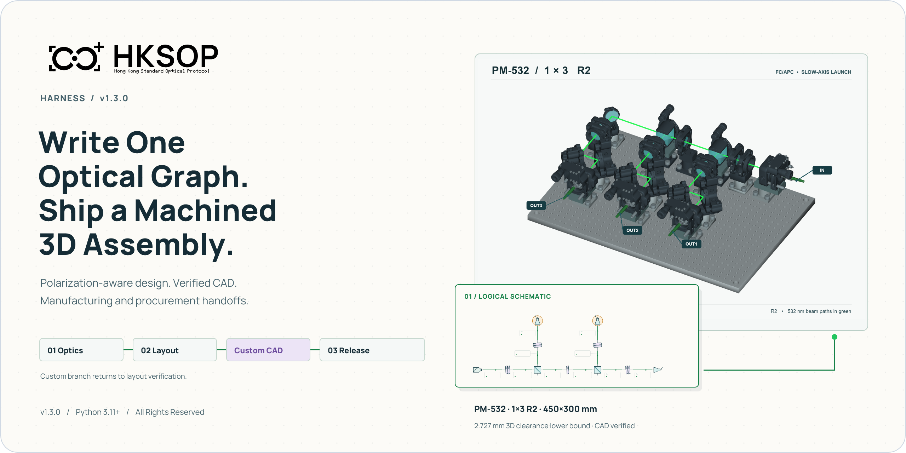
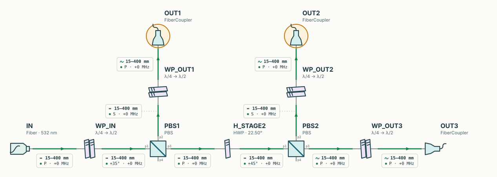
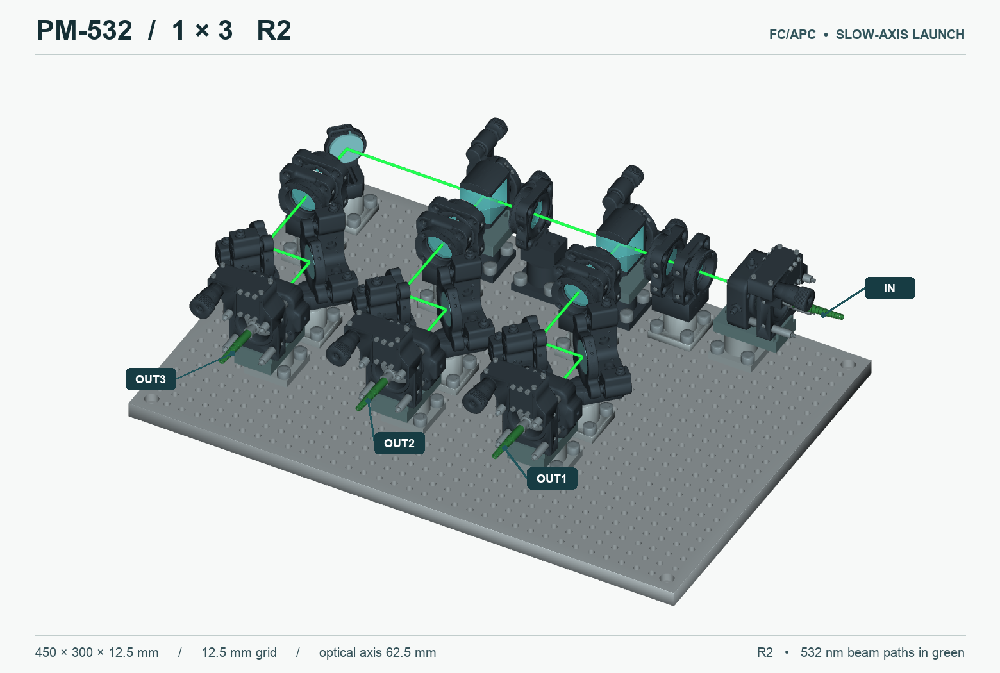

<a href="README.md">简体中文 ↗</a> &nbsp;|&nbsp; <strong>English</strong> &nbsp;·&nbsp; <a href="https://ustcredapple-dotcom.github.io/HKSOP-Harness/?lang=en">Interactive Showcase ↗</a>

Optical Graph → Board Layout → 3D Verification & Manufacture <small>Custom CAD is an optional branch that returns to board verification</small>

<a href="#start-with-the-532-nm-fiber-splitter">PM-532 digital design example</a> · <a href="#install-into-agent-clients">Three-client installation</a> · <a href="https://github.com/ustcredapple-dotcom/HKSOP">HKSOP Core</a> · <a href="compatibility.json">Compatibility v1.3.0</a> · <a href="LICENSE">All Rights Reserved</a>

# HKSOP Harness

Start with an executable optical graph, calculate port power and polarization, produce a breadboard layout and native HKSOP project, then check beam clearance against real 3D geometry and export manufacturing and assembly/procurement packages. Four independent plugins pass their results through files.

| Stage | Plugin | Handoff |
|---|---|---|
| 1 · Optical Graph | hksop-step1-optics | Schematic, port trace, Gaussian beams and diagnostics |
| 2 · Board Layout | hksop-step2-board | Board, stages, access areas, holes, native project and custom wishes |
| Custom branch | hksop-custom-part | Adapter tasks, machining documents and controlled library intake |
| 3 · 3D & Manufacture | hksop-step3-manufacture | Solid STEP assembly, beam clearance, BOM and two release packages |

## Start with the 532 nm fiber splitter

Run these commands from the repository root. Layer 1 requires Python 3.11 or later and only the standard library.

~~~sh
python3 scripts/optical_graph_render.py examples/pm-fiber-1x3-532/graph.py --func build_graph -o results/pm532/gallery.html --svg results/pm532/schematic.svg --json results/pm532/trace.json
python3 tests/optical_graph_acceptance.py
python3 tests/pm_optics_checks.py
~~~

R2 launches from the east and has three equally spaced outputs on the south edge. Four QWP–HWP pairs compensate polarization at the input and outputs; one inter-stage HWP sets the remaining split ratio.

The board is 450 × 300 × 12.5 mm, with a 12.5 mm M6 grid, a 62.5 mm optical axis and 112.5 mm output spacing. The verified digital assembly has 21 beam segments and a minimum clearance lower bound of 2.727 mm. The design back focal length is 5.677 mm, with 0.50 mm travel from the midpoint to each mechanical endpoint. A 3 mW input yields 1 mW per output in the **lossless model**. Physical output power, insertion loss and PER still require measurement at 532 nm; the system target is PER ≥ 20 dB. [Example and geometry provenance](examples/pm-fiber-1x3-532/README.md)

## Connect HKSOP Core

Harness handles design, verification and plugin handoffs. Core provides the native engine, component catalog and authorized assets. The validated catalog is **hksop-20261122-curated-r1**. The inspected upstream main commit identifies its catalog metadata as `2026-11-12.standard-restored-no-r8`. Layout and 3D verification require the generated curated catalog pinned in the compatibility manifest; cloning that upstream commit alone is not sufficient. [HKSOP Core](https://github.com/ustcredapple-dotcom/HKSOP) · [Pinned versions, required files and SHA-256](compatibility.json)

Select the core with `--root`, set `HKSOP_ROOT`, or place a compatible `HKSOP` / `HKSOP-refactored` next to this repository. Node resolution checks `HKSOP_NODE`, Core's `config/local-environment.json`, the DeepSeek Harness runtime and finally the system `PATH`, verifying that each candidate can actually run.

~~~sh
export HKSOP_ROOT=/path/to/HKSOP
python3 scripts/optical_graph_to_board.py results/pm532/trace.json --root "$HKSOP_ROOT" --board 450x300 --pitch 12.5 --height-policy fixed -o results/board
python3 plugins/hksop-custom-part/skills/custom-part-cad/scripts/parse_wishes.py results/board/custom-wishes.json -o results/cad-tasks.json
python3 tests/layer2_acceptance.py
python3 tests/pm_layout_checks.py
~~~

The 3D stage requires a Python interpreter with the OpenCascade bindings (`cadquery-ocp`, imported as `OCP`) and NumPy. Use `--vendor` for the four specified supplier STEP files acquired under their original terms, or `--fetch` to retrieve them from the registered supplier URLs and verify their hashes. Keep private geometry outside this repository. Existing prepared geometry can be selected with `HKSOP_FOCUS_ASSETS`.

~~~sh
export HKSOP_CAD_PYTHON=/path/to/cad-python
export HKSOP_FOCUS_ASSETS="$HOME/.cache/hksop-harness/pm532"
"$HKSOP_CAD_PYTHON" scripts/prepare_focus_assets.py --root "$HKSOP_ROOT" --vendor /path/to/licensed-models -o "$HKSOP_FOCUS_ASSETS"
VERIFY=plugins/hksop-step3-manufacture/skills/json-to-3d-verify/scripts
python3 "$VERIFY/prepare_geometry.py" results/board/project.zzoptics.json --root "$HKSOP_ROOT" --ledger results/board/step5_hole_ledger.json -o results/geometry
"$HKSOP_CAD_PYTHON" "$VERIFY/check_3d_beam_clearance.py" results/board/project.zzoptics.json --geometry results/geometry/geometry.json --assembly results/release/assembly.step --board-step results/release/board.step -o results/release/beam_clearance_3d.json
python3 tests/plugins_acceptance.py
~~~

The complete relay checks the CRC and frozen contents of both ZIPs. For a new release, use the export plugin's controlled manifest interface. [3D verification](plugins/hksop-step3-manufacture/skills/json-to-3d-verify/SKILL.md) · [Package interface](plugins/hksop-step3-manufacture/skills/export-packages/SKILL.md)

## Install into agent clients

Without `--apply`, the installer only previews the plan. Choose the command for the client you use; each installs four independent plugins.

~~~sh
python3 scripts/install_plugins.py --client antigravity --apply
python3 scripts/install_plugins.py --client codex --apply
python3 scripts/install_plugins.py --client dsh --apply
~~~

| Client | Default directory | Enablement |
|---|---|---|
| Antigravity | ~/.gemini/config/plugins | Enable the required stages in the client's plugin interface. |
| Codex | ~/.codex/local-marketplaces/hksop/plugins | Add this repository's `hksop-local` local marketplace on first use, then select the plugins. The manifest is `.agents/plugins/marketplace.json`. Existing registrations keep their entry point. Add `--update --sync-codex-cache` to refresh an active cache under `~/.codex/plugins/cache/hksop-local`; previous cache versions are backed up. |
| DeepSeek Harness | ~/.dsh/local-plugins | Select the generated local Cordis packages in the desktop plugin manager; enable each independently. |

Use `--target` for a project-local installation. `--update --apply` verifies ownership before upgrading copies or links; unrecognized or locally edited contents block replacement. `--mode symlink` explicitly selects developer links. Account settings, enablement lists and global client configuration remain managed by the host.

## Tests and maintenance

~~~sh
python3 tests/test_repo_hygiene.py
python3 tests/optical_graph_acceptance.py
python3 tests/pm_optics_checks.py
python3 tests/plugins_acceptance.py --offline
python3 tests/packaging_regression.py
python3 tests/showcase_acceptance.py
~~~

Offline acceptance verifies native manifests, four generated Cordis packages, stage isolation, optical handoffs and installation/upgrades for all three clients in temporary directories. Full acceptance additionally runs native HKSOP verification and 3D clearance checks. It can rebuild focusing heads from authorized local supplier files specified by `HKSOP_VENDOR_DIR`, from a migrated sibling installation, or from the registered supplier downloads. When automated downloads are unavailable, supply the files with `--vendor`.

The repository uses **strategy B: zero-build native plugins**. `src/` and `scripts/` remain the authoring sources; each native plugin retains only its independently required, explicitly mapped runtime copies. Codex can load the existing local marketplace immediately after cloning. DSH retains only 16 host-wrapper files in `packaging/dsh/`; the installer assembles complete payloads into ignored `dist/dsh-plugins/`. A wrapper directory alone is not an installable plugin.

Release versions are controlled by `packaging/release.json`. After editing authoring sources, run `python3 scripts/sync_plugins.py --apply`, then `--check` and the relevant acceptance tests. Derived native manifests, runtime copies and shared policies must match their sources. [Architecture](docs/architecture.md) · [Refactoring record](docs/refactoring-1.3.0.md)

## Bilingual showcase

[Open the interactive page](https://ustcredapple-dotcom.github.io/HKSOP-Harness/?lang=en), or download `docs/index.html` and open it offline. Its icons, schematic, assembly image and fonts are embedded; no network resources are required. Language switching updates the entire UI, query parameter and local preference. The viewer supports schematic, 3D assembly and split comparison. README uses PNG covers for reliable GitHub rendering.

Edit text in `docs/showcase.i18n.json` and layout in `docs/showcase.template.html`; run `python3 scripts/build_showcase.py` to regenerate the standalone page. See [showcase maintenance](docs/showcase-maintenance.md) for outlined SVG covers, PNG export, provenance and checks.

Manrope is used under SIL OFL 1.1. The repository itself is **All Rights Reserved** and grants no open-source license. Supplier models are obtained separately under their owners' terms. [Distribution terms](LICENSE)
