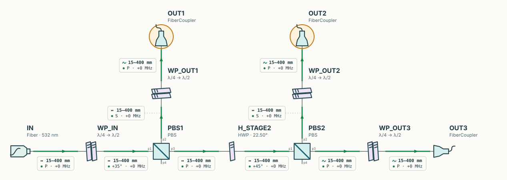
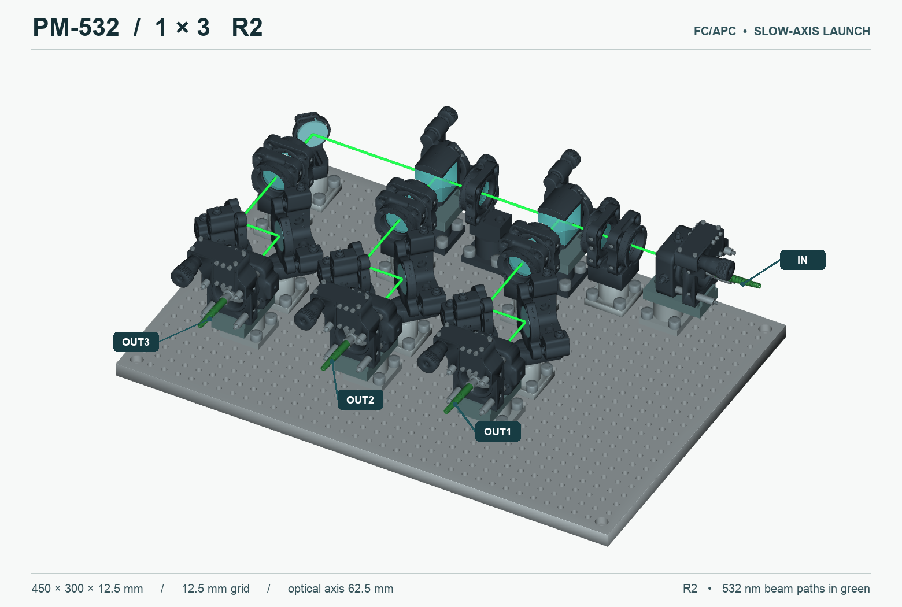

# HKSOP Harness

用一张可执行的光路图，计算端口功率与偏振，生成二维排板和原生 HKSOP 工程，再对真实三维总装做净空检查，导出加工包和装配采购包。四个插件可单独使用，步骤之间通过文件交接。

| 步骤 | 插件 | 交付 |
|---|---|---|
| 1 · 光路原理 | hksop-step1-optics | 原理图、端口追迹、光斑和诊断 |
| 2 · 排板 | hksop-step2-board | 板型、滑台、手位、孔位、原生工程与定制需求 |
| 定制支线 | hksop-custom-part | 转接件任务、加工资料、受控的器件入库 |
| 3 · 三维与制造 | hksop-step3-manufacture | 实体 STEP、光束净空、BOM 和两个交付包 |

## 从 532 nm 光纤一分三开始

下列命令从仓库根目录运行。第一层只需 Python 3.11 或更新版本。

~~~sh
python3 scripts/optical_graph_render.py examples/pm-fiber-1x3-532/graph.py --func build_graph -o results/pm532/gallery.html --svg results/pm532/schematic.svg --json results/pm532/trace.json
python3 tests/optical_graph_acceptance.py
python3 tests/pm_optics_checks.py
~~~

R2 采用东侧输入、南侧三路等距输出。四组双波片用于输入与输出偏振补偿，级间一片 HWP 用于调平。

三维图来自已校核的装配模型。无损模型下 3 mW 输入对应每路 1 mW。实际远端功率和 PER 需在 532 nm 下装调测量。[示例与几何来源](examples/pm-fiber-1x3-532/README.md)

## 对接 HKSOP 本体

本仓库负责设计、验收与插件交接。本体负责原生引擎、元件目录及其授权资产。已联调的目录版本为 **hksop-20261122-curated-r1**。上游 main 的已核对版本在 library/catalog-meta.json 中标记为 2026-11-12.standard-restored-no-r8。排板和三维使用兼容清单指定的已生成目录；仅克隆该上游提交还需准备匹配的整理版元件库。[HKSOP 本体](https://github.com/ustcredapple-dotcom/HKSOP) · [兼容版本、文件要求与 SHA-256](compatibility.json)

可在命令行指定 --root，也可设置 HKSOP_ROOT，或把兼容的 HKSOP / HKSOP-refactored 与此仓库并列放置。Node 按 HKSOP_NODE、本体 config/local-environment.json、DeepSeek Harness 自带解释器、系统 PATH 的顺序验证实际可执行性。

~~~sh
export HKSOP_ROOT=/path/to/HKSOP
python3 scripts/optical_graph_to_board.py results/pm532/trace.json --root "$HKSOP_ROOT" --board 450x300 --pitch 12.5 --height-policy fixed -o results/board
python3 plugins/hksop-custom-part/skills/custom-part-cad/scripts/parse_wishes.py results/board/custom-wishes.json -o results/cad-tasks.json
python3 tests/layer2_acceptance.py
python3 tests/pm_layout_checks.py
~~~

三维复验使用安装有 OpenCascade Python 绑定 OCP 和 NumPy 的解释器。用 --vendor 读取自行取得的四种指定型号 STEP，或用 --fetch 从固定的原厂地址获取并核对哈希。将私有几何目录置于仓库之外。已准备好的几何可直接由 HKSOP_FOCUS_ASSETS 指定。

~~~sh
export HKSOP_CAD_PYTHON=/path/to/cad-python
export HKSOP_FOCUS_ASSETS="$HOME/.cache/hksop-harness/pm532"
"$HKSOP_CAD_PYTHON" scripts/prepare_focus_assets.py --root "$HKSOP_ROOT" --vendor /path/to/licensed-models -o "$HKSOP_FOCUS_ASSETS"
VERIFY=plugins/hksop-step3-manufacture/skills/json-to-3d-verify/scripts
python3 "$VERIFY/prepare_geometry.py" results/board/project.zzoptics.json --root "$HKSOP_ROOT" --ledger results/board/step5_hole_ledger.json -o results/geometry
"$HKSOP_CAD_PYTHON" "$VERIFY/check_3d_beam_clearance.py" results/board/project.zzoptics.json --geometry results/geometry/geometry.json --assembly results/release/assembly.step --board-step results/release/board.step -o results/release/beam_clearance_3d.json
python3 tests/plugins_acceptance.py
~~~

完整接力测试包含两个实际 ZIP 的 CRC 和冻结文件校验。需要新建加工包时，使用导出插件的冻结清单接口。[三维复核](plugins/hksop-step3-manufacture/skills/json-to-3d-verify/SKILL.md) · [交付包接口](plugins/hksop-step3-manufacture/skills/export-packages/SKILL.md)

## 安装到客户端

默认操作只显示安装计划。加入 --apply 会复制四个独立插件。以下三条分别对应三个客户端，根据要使用的客户端执行相应一条。

~~~sh
python3 scripts/install_plugins.py --client antigravity --apply
python3 scripts/install_plugins.py --client codex --apply
python3 scripts/install_plugins.py --client dsh --apply
~~~

| 客户端 | 默认目录 | 如何启用 |
|---|---|---|
| Antigravity | ~/.gemini/config/plugins | 在客户端的插件界面启用所需步骤 |
| Codex | ~/.codex/local-marketplaces/hksop/plugins | 已登记 hksop-local 的环境沿用原入口，更新时可追加 `--sync-codex-cache` 同步 `~/.codex/plugins/cache/hksop-local` 并备份旧版缓存。首次使用可在 Codex 添加本仓库的本地市场，再选装四个插件；市场清单位于 .agents/plugins/marketplace.json |
| DeepSeek Harness | ~/.dsh/local-plugins | 在桌面插件管理中选择对应本地 Cordis 包，可逐项启停 |

指定 --target 可将实体文件安装到项目目录。--update --apply 会核对来源后升级已安装的副本或链接；本地改动引起的哈希差异会阻止替换。显式使用 --mode symlink 可改为指向源码的链接。客户端账号、启用列表及全局配置由宿主管理。

## 测试与维护

~~~sh
python3 tests/test_repo_hygiene.py
python3 tests/optical_graph_acceptance.py
python3 tests/pm_optics_checks.py
python3 tests/plugins_acceptance.py --offline
~~~

离线验收在临时目录验证双端清单、四个 Cordis 包、阶段隔离、第 1 棒接力及三端安装升级。完整验收还会运行 HKSOP 原生 verify 和三维终检；如有 HKSOP_VENDOR_DIR 指定的合法本地原厂文件，完整测试会逐件核对哈希，在临时工作区重建调焦头。迁移已有安装时也支持与本体并列的旧版 HKSOP harness 中的原厂文件。其余环境可使用预置的调焦头，或从原厂下载；原厂限制自动下载时使用 --vendor。src 的修改先用 scripts/sync_plugins.py --apply 同步，再运行 --check 和验收。[架构与规范](docs/architecture.md) · [使用与分发条款](LICENSE)
