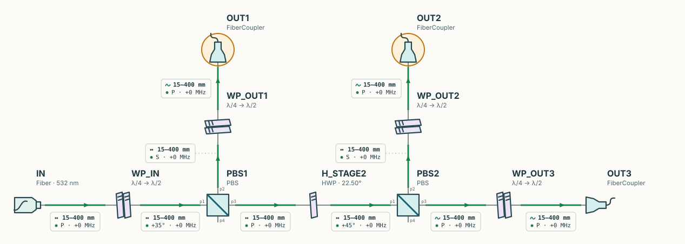
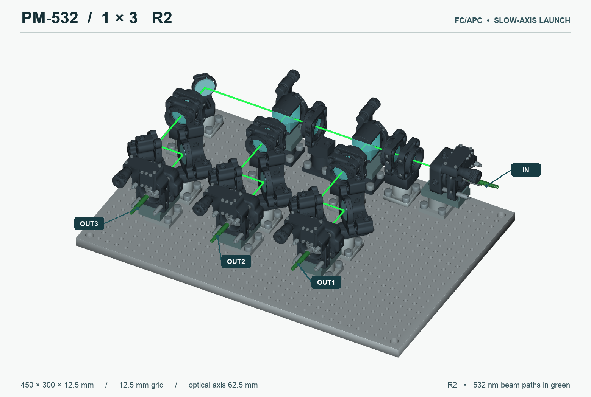

# 532 nm 保偏光纤一进三出 · R2

东侧保偏光纤输入，南侧三个输出以 112.5 mm 等距展开。四个窄键 FC/APC 的慢轴都平行板面。入口和三个输出各带一组 QWP → HWP，两级 PBS 的透射直通段使用一片 HWP。在 3 mW 无损模型中，三路各为 1 mW。

成品底板为 450 × 300 × 12.5 mm，孔距 12.5 mm，光高 62.5 mm。数字总装中 21 段光束的最小净空下界为 2.727 mm。A240TM-A 前镜与移动的窄键光纤端面之间的设计后截距为 5.677 mm，中点到两个机械终点各余 0.50 mm。现场需在 532 nm 另测功率、插损和偏振消光比，系统目标为 PER ≥ 20 dB。

graph.py 是可执行的纯光学输入。asset-sources.json 只存四个原厂模型的来源、型号及校验和，kit-datums.json 是光学基准登记。复算所需的真实几何可用仓库的准备命令在私有工作目录中生成。[运行说明](../../README.md)
